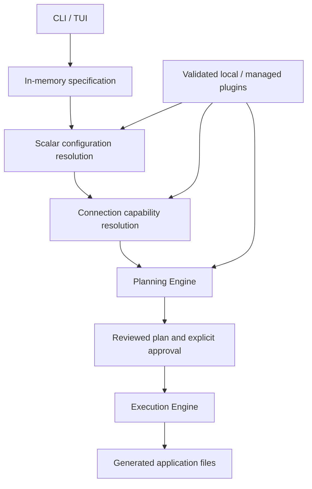

# Architecture

ProvisionHub is a local-first, one-time project initializer. One process hosts the Cobra CLI or Bubble Tea TUI and shares application services with the Planning and Execution Engines.

| Boundary | Responsibility |
| --- | --- |
| CLI/TUI | Collect selections, present diagnostics and a plan, require approval |
| Project and catalog | Validate component names, technologies, paths, and conflicts |
| Configuration | Validate plugin-defined scalar options and resolve defaults per component without I/O |
| Connections | Match named provider/consumer slots, resolve metadata/options, reject ambiguity and dependency cycles |
| Plugins | Load declarative plugin manifests, validate templates and paths, select installed versions |
| Planning | Build deterministic operations and diagnostics without writes or network access |
| Execution | Recheck a reviewed plan and publish root-confined files without overwrite |
| Local SQLite | Persist Settings, Git account metadata, and managed plugin installation metadata |
| Registry | Discover and install official plugin packages on explicit request |

The project specification is a Go value and is never serialized to a project YAML file. No project lockfile or saved-project registration is created. SQLite is optional when generators are supplied through an explicit local plugin directory; installed managed plugins use SQLite metadata and artifact integrity checks. The project directory remains usable without ProvisionHub after generation. Historical saved-project database rows and existing project files are left untouched.

The [connection contract](../component-connections.md) and
[ADR-0013](../adr/0013-component-connections.md) extend the existing engines with
optional plugin-owned integration files. This is source generation; the core
does not provide networking, runtime discovery, or deployment orchestration.

The plugin packaging format is unchanged. Plugin manifests are YAML, independent of the retired project YAML format. Optional configuration declarations and escaped literal references are defined by the [configuration contract](../plugin-configuration.md) and [ADR-0012](../adr/0012-declarative-component-configuration.md). The [plugin guide](../plugin-registry.md) describes installation and version selection. [Generation planning](../generation-planning.md) describes safety and limitations. [ADR-0011](../adr/0011-one-time-project-generation.md) records the product-direction change from [ADR-0007](../adr/0007-named-project-components.md) and [ADR-0010](../adr/0010-project-plugin-locking.md).
